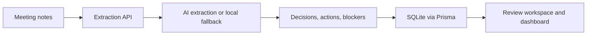

# Meeting-to-Momentum

**Turn meeting notes into traceable decisions, accountable action items, and visible momentum.**

Meeting-to-Momentum is a local-first workspace for teams that want a meeting to result in more than a summary. Paste a transcript, extract the important outcomes, review them against their source text, and keep decisions, owners, due dates, and blockers visible in one place.

## What it does

- Extracts a concise summary, decisions, action items, owners, due dates, and blockers from meeting notes.
- Preserves a source quote and confidence score with every extracted record.
- Lets users review and update action status, ownership, decisions, and blocked work.
- Shows workspace and personal views for tracking active, overdue, and blocked work.
- Persists the shared workspace in SQLite and keeps the latest extraction available locally in the browser.

## Product flow

1. Paste a meeting title and transcript.
2. Extract structured outcomes from the notes.
3. Review the source-backed actions, decisions, and blockers.
4. Update ownership or status as the team makes progress.
5. Use the dashboard to see where follow-up is needed.

## Built with Codex & GPT-5.6

This project was built in collaboration with **Codex, powered by GPT-5.6**. The model served as a hands-on engineering partner throughout the prototype:

- Translated the product brief into the Next.js/TypeScript application structure and component boundaries.
- Implemented the meeting-intelligence workflow, dashboard, review interactions, and responsive UI.
- Designed the extraction contract for summaries, actions, decisions, blockers, confidence, and source attribution.
- Added the Prisma data model, SQLite persistence, demo seed data, and API routes for workspace updates.
- Helped iterate on error states, local fallbacks, and the end-to-end demo experience.
- Reviewed the implementation and verified the production build.

The application’s runtime extraction path uses the OpenAI API when `OPENAI_API_KEY` is available; it falls back to Gemini when `GEMINI_API_KEY` is configured, then to a deterministic local parser so the prototype remains usable without credentials.

## Stack

- Next.js 16 and React 19
- TypeScript
- Prisma with SQLite
- OpenAI Chat Completions API for optional AI extraction
- Local deterministic extraction fallback

## Architecture



## Run locally

Prerequisites: Node.js 20+ and npm.

```bash
npm install
npx prisma generate
npm run dev
```

Open [http://localhost:3000](http://localhost:3000).

The repository includes a local SQLite database with demo content. To recreate the database schema from scratch, run:

```bash
npx prisma db push
```

To enable model-backed extraction, create `.env.local` and add one of the following:

```bash
OPENAI_API_KEY=your_openai_api_key
# or
GEMINI_API_KEY=your_gemini_api_key
```

Without an API key, the app still runs using its local pattern-based extraction fallback.

## Verify

```bash
npm run lint
npm run typecheck
npm run build
```

## Demo

Use the preloaded **Launch readiness** notes, select **Extract momentum**, then review the resulting decision, actions, and blocker. Change an owner or status and use the dashboard filters to surface blocked or overdue work.

## Roadmap

- Calendar, video-conferencing, Slack, and email integrations
- Authentication and multi-workspace support
- Human review and audit history for extraction corrections
- Scheduled follow-up delivery
- Production database and deployment configuration

